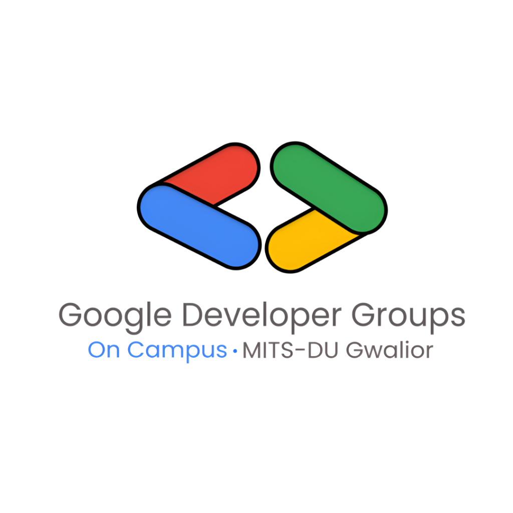

# GDG DevSummit 2026 • Event Registration Dashboard
### Google Developer Groups (GDG) On Campus • MITS Gwalior
**Official Event Registration & Live Participant Directory Portal**

 

---

## 📌 Project Overview
This project is a high-performance, responsive **Event Registration Dashboard** engineered for **GDG DevSummit 2026**, the flagship annual technical summit organized by **Google Developer Groups (GDG) On Campus** at **Madhav Institute of Technology & Science (MITS-DU Gwalior)**.

The application allows students to register for specialized technical tracks, validates registration data in real-time, generates dynamic admit passes with scannable QR codes, and provides organizers with an interactive real-time management dashboard complete with search, filtering, and visual analytics.

---

## 🌟 Key Features

### 1. Event Details & Registration Form
- **Comprehensive Event Showcase**: Displays summit dates (Oct 24–25, 2026), venue (Colloquium Hall, MITS Gwalior), eligibility, 150-seat capacity progress bar, and perks.
- **Track Selection**: 4 specialization tracks:
  - *Google Cloud & DevOps (GDG Cloud)*
  - *Applied AI & Machine Learning (GDG AI)*
  - *Android & Flutter Development (GDG Mobile)*
  - *Modern Web & Cloud Systems (GDG Web)*
- **Community Crew Showcase**: Features the Google Developer Groups MITS Organizing Crew.
- **Evaluator Autofill Helper**: 1-click **"Fill Demo Student Data"** button to rapidly populate realistic test submissions.

### 2. Client-Side Form Validation
- **Real-Time Feedback**: Validates fields on `input` and `blur` events with visual status cues (green checkmarks / red alert borders).
- **Format Integrity**:
  - Full Name validation (alphabetical, min 3 characters).
  - Strict RFC-compliant email regex.
  - 10-digit Indian mobile number validation.
  - Enrollment / Roll number format check.
- **Duplicate Prevention**: Prevents double registrations by actively checking input emails and roll numbers against existing records.
- **Micro-Interactions**: Shake animation and smooth auto-scrolling to the first invalid field upon error.

### 3. Participant Directory & Live Dashboard
- **Live KPI Counters**:
  - Total Registered Participants (`/ 150 Cap`)
  - Seats Remaining (auto-calculated)
  - Real-time Check-In Rate & Percentage
  - GDG Member Count
- **Dual Responsive Layout**:
  - **Desktop View**: Sleek, high-density table with initials avatars, branch details, status badges, and action buttons.
  - **Mobile View**: Touch-optimized cards designed for smartphones and tablets.
- **Action Triggers on Records**:
  - *Toggle Check-in*: Instantly switch attendee status between `Confirmed` and `Checked-in`.
  - *View Admit Pass*: Opens the participant's personalized digital ticket modal.
  - *Delete*: Safely remove records with confirmation.

### 4. Live Search, Multi-Filter & Sorting
- **Instant Search**: Real-time debounce query matching across attendee Name, Roll Number, Email, and Registration ID.
- **Multi-Level Filters**:
  - Filter by Specialization Track (Cloud, AI, Mobile, Web)
  - Filter by Year of Study (1st, 2nd, 3rd, 4th Year)
  - Filter by Status (Confirmed, Checked-in)
- **Sorting**: Order by Newest First, Oldest First, Name (A–Z), and Name (Z–A).
- **Clear Filters**: 1-click reset for all filter dropdowns.

### 5. Visual Analytics & Reporting
- **Chart.js Integration**: Toggleable interactive charts styled in Google Developer palette:
  - Track Distribution (Doughnut Chart)
  - Year of Study Breakdown (Bar Chart)
- **Data Exporting**:
  - **Export to CSV**: Generates a standard UTF-8 CSV spreadsheet (`GDG_DevSummit_Participants_2026.csv`) containing all filtered participant records.
- **LocalStorage Persistence**: All new registrations, check-in updates, and deletions automatically persist across page refreshes.

### 6. Digital Admit Pass / Ticket Generator
- Upon registration (or clicking the ticket icon), a customized admit card is displayed with:
  - Participant ID (e.g., `GDG-2026-1009`)
  - Attendee details & track
  - Dynamically generated SVG QR Code
  - **Print / Save as PDF** support with print-optimized stylesheets (`@media print`).

---

## 📁 Project Structure

```
gdg-event-registration-dashboard/
├── index.html            # Core HTML5 semantic markup with Tailwind CSS CDN
├── styles.css            # Custom styles, glassmorphism, animations, print CSS
├── js/
│   ├── app.js            # Core validation logic, search/filters, ticket modal
│   ├── data.js           # LocalStorage store with realistic MITS student seeds
│   ├── chart.js          # Interactive Chart.js analytics visualizations
│   ├── script.js         # Interactivity helpers
│   └── firebase-init.js  # Optional Firebase Firestore real-time sync config
├── mits-logo.png         # Official MITS Gwalior logo
├── gdg-logo.png          # Official Google Developer Groups MITS logo
├── gdg-crew.jpg          # GDG MITS crew members photo
└── README.md             # Complete documentation and deployment guide
```

---

## 🚀 How to Run Locally

1. Clone or open the project folder in any modern browser.
2. Open `index.html` directly in Google Chrome, Microsoft Edge, or Mozilla Firefox.
3. No build step or Node.js environment is required — all dependencies are loaded via high-availability CDNs.
