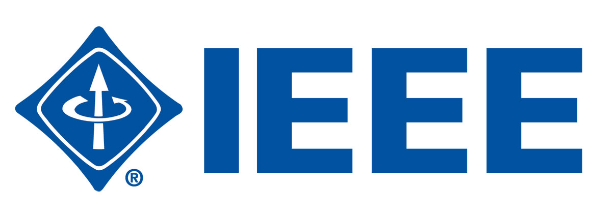

# IEEE InnovateX 2026 • Event Registration Dashboard
### IEEE IAS & RAS Student Branch Chapters • MITS Gwalior
**Recruitment Drive 2026 — Technical Domain: Task 3**

  

---

## 📌 Project Overview
This project is a high-performance, responsive **Event Registration Dashboard** engineered for **IEEE InnovateX 2026**, a flagship technical summit organized jointly by the **IEEE Industry Applications Society (IAS)** and **IEEE Robotics & Automation Society (RAS)** Student Branch Chapters at **Madhav Institute of Technology & Science (MITS Gwalior)**.

The application allows students to register for technical tracks, validates registration data in real-time, generates dynamic admit passes with scannable QR codes, and provides organizers with an interactive real-time management dashboard complete with search, filtering, and visual analytics.

---

## 🌟 Key Features (Fulfilling All Task 3 Requirements)

### 1. Event Details & Registration Form
- **Comprehensive Event Showcase**: Displays summit dates (Oct 24–25, 2026), venue (Colloquium Hall, MITS Gwalior), eligibility, 150-seat capacity progress bar, and perks.
- **Track Selection**: 4 specialization tracks:
  - *Robotics & Hardware (IEEE RAS Track)*
  - *Industrial IoT & Automation (IEEE IAS Track)*
  - *Applied AI & Computer Vision*
  - *RoboCode & Web Systems*
- **Live Countdown Timer**: Real-time ticker counting down to event kickoff.
- **Evaluator Autofill Helper**: 1-click **"Fill Demo Student Data"** button to rapidly populate realistic test submissions.

### 2. Client-Side Form Validation
- **Real-Time Feedback**: Validates fields on `input` and `blur` events with visual status cues (green checkmarks / red alert borders).
- **Format Integrity**:
  - Full Name validation (alphabetical, min 3 characters).
  - Strict RFC-compliant email regex.
  - 10-digit Indian mobile number validation.
  - Enrollment / Roll number format check.
- **Duplicate Prevention**: Prevents double registrations by actively checking input emails and roll numbers against existing records.
- **Micro-Interactions**: Shake animation and smooth auto-scrolling to the first invalid field upon error.

### 3. Participant Directory & Live Dashboard
- **Live KPI Counters**:
  - Total Registered Participants (`/ 150 Cap`)
  - Seats Remaining (auto-calculated)
  - Real-time Check-In Rate & Percentage
  - IEEE Member Count
- **Dual Responsive Layout**:
  - **Desktop View**: Sleek, high-density table with initials avatars, branch details, status badges, and action buttons.
  - **Mobile View**: Touch-optimized cards designed for smartphones and tablets.
- **Action Triggers on Records**:
  - *Toggle Check-in*: Instantly switch attendee status between `Confirmed` and `Checked-in`.
  - *View Admit Pass*: Opens the participant's personalized digital ticket modal.
  - *Delete*: Safely remove records with confirmation.

### 4. Live Search, Multi-Filter & Sorting
- **Instant Search**: Real-time debounce query matching across attendee Name, Roll Number, Email, and Registration ID.
- **Multi-Level Filters**:
  - Filter by Specialization Track (RAS, IAS, AI, RoboCode)
  - Filter by Year of Study (1st, 2nd, 3rd, 4th Year)
  - Filter by Status (Confirmed, Checked-in)
- **Sorting**: Order by Newest First, Oldest First, Name (A–Z), and Name (Z–A).
- **Clear Filters**: 1-click reset for all filter dropdowns.

### 5. Visual Analytics & Reporting
- **Chart.js Integration**: Toggleable interactive charts:
  - Track Distribution (Doughnut Chart)
  - Year of Study Breakdown (Bar Chart)
- **Data Exporting**:
  - **Export to CSV**: Generates a standard UTF-8 CSV spreadsheet (`IEEE_InnovateX_Participants_2026.csv`) containing all filtered participant records.
- **LocalStorage Persistence**: All new registrations, check-in updates, and deletions automatically persist across page refreshes.

### 6. Digital Admit Pass / Ticket Generator
- Upon registration (or clicking the ticket icon), a customized admit card is displayed with:
  - Participant ID (e.g., `INX-2026-1009`)
  - Attendee details & track
  - Dynamically generated SVG QR Code
  - **Print / Save as PDF** support with print-optimized stylesheets (`@media print`).

---

## 📁 Project Structure

```
ieee-event-registration-dashboard/
├── index.html            # Core HTML5 semantic markup with Tailwind CSS CDN
├── css/
│   └── styles.css        # Custom styles, glassmorphism, animations, print CSS
├── js/
│   ├── app.js            # Core validation logic, search/filters, ticket modal
│   ├── data.js           # LocalStorage store with realistic MITS student seeds
│   └── chart.js          # Interactive Chart.js analytics visualizations
├── assets/
│   ├── ieee-logo.jpg     # Official IEEE logo
│   ├── ias-logo.jpg      # Official IEEE IAS logo
│   ├── ras-logo.jpg      # Official IEEE RAS logo
│   └── footer-image.jpg  # Official recruitment drive footer banner
└── README.md             # Complete documentation and deployment guide
```

---

## 🚀 How to Run Locally

You do not need to install Node.js, npm, or any server. 

1. Simply double-click `index.html` to open it directly in Google Chrome, Microsoft Edge, Firefox, or Safari.
2. Everything (icons, styling, charts, storage) works out of the box!

---

## 🌐 How to Deploy and Make the Website "Open for All"

To submit your task, you need a **GitHub Repository URL** and a **Live Site URL**. Choose any of the following 100% free hosting methods:

### Option 1: Deploy in 30 Seconds via Netlify Drop (Easiest & Fastest)
1. Go to [https://app.netlify.com/drop](https://app.netlify.com/drop) in your browser.
2. Drag and drop the entire `ieee-event-registration-dashboard` folder onto the page.
3. Netlify will instantly provide a live URL like `https://ieee-innovatex-2026.netlify.app`.
4. Anyone in the world can now open your website!

---

### Option 2: Deploy to GitHub & GitHub Pages (Recommended for Submission)

#### Step A: Create a Repository on GitHub
1. Log in to [GitHub](https://github.com/) and click **New Repository**.
2. Name it `ieee-event-registration-dashboard`.
3. Keep it **Public** and leave "Initialize with README" unchecked. Click **Create repository**.

#### Step B: Upload Files via Browser (No Terminal Required)
1. On your newly created GitHub repository page, click **uploading an existing file**.
2. Drag and drop all the files from this folder (`index.html`, `css/`, `js/`, `assets/`, `README.md`).
3. Click **Commit changes**.

#### Step C: Enable GitHub Pages (Free Live Website)
1. In your GitHub repository, go to **Settings** (top tab).
2. On the left sidebar, click **Pages**.
3. Under **Build and deployment > Branch**, select `main` (or `master`) and folder `/ (root)`.
4. Click **Save**.
5. Wait ~60 seconds, and your live URL will be ready at:
   `https://<your-github-username>.github.io/ieee-event-registration-dashboard/`

---

### Option 3: Deploy to Vercel
1. Go to [https://vercel.com/](https://vercel.com/) and log in.
2. Click **Add New > Project** and select your GitHub repository.
3. Leave all build settings default (Framework Preset: Other) and click **Deploy**.
4. Your site will be live instantly with a free `.vercel.app` domain.

---

## 📝 Recruitment Submission Checklist
- [x] Correct domain selected (**Technical**)
- [x] Correct task selected (**Task 3: Event Registration Dashboard**)
- [x] Event details and registration form included
- [x] Client-side form validation implemented with error states
- [x] Participant list with table & card layouts
- [x] Real-time search and multi-filtering (track, year, status)
- [x] Clean, responsive UI featuring official IEEE IAS & RAS branding
- [x] GitHub repository ready to push
- [x] Live deployment ready for GitHub Pages / Netlify / Vercel

---
*Created for IEEE IAS & RAS Student Branch Chapters • MITS Gwalior Recruitment Drive 2026.*
